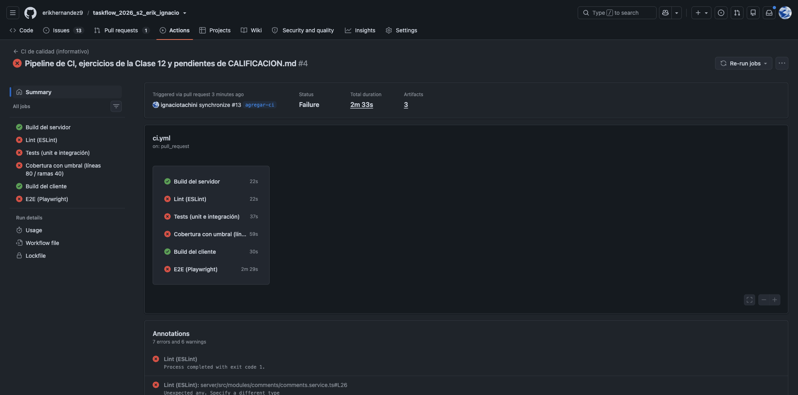

# Clase 12 · Ejercicio 1 — El pipeline en nuestro repo

## 1A · El pipeline corriendo

- **Workflow:** `.github/workflows/ci.yml` ("CI de calidad (informativo)"), el
  `ci.yml` del curso más un job de E2E (Ejercicio 1C).
- **Rama y PR:** `agregar-ci` →
  [PR #13](https://github.com/erikhernandez9/taskflow_2026_s2_erik_ignacio/pull/13).
- **Corridas:** cada commit corre dos veces, una por el push y otra por el PR.
  La que se lee acá es la del commit `0dbbed9`
  ([run del PR 45474481488](https://github.com/erikhernandez9/taskflow_2026_s2_erik_ignacio/actions/runs/45474481488),
  [run del push 45474465401](https://github.com/erikhernandez9/taskflow_2026_s2_erik_ignacio/actions/runs/45474465401)).
  La primera corrida fue la del commit `1560488`
  ([run 45473769858](https://github.com/erikhernandez9/taskflow_2026_s2_erik_ignacio/actions/runs/45473769858)).
- **Duración total:** 2 min 33 s. El job más lento es el de E2E (2 min 29 s).
- **Artefactos de cada corrida:** `cobertura` (lcov), `playwright-report` y
  `playwright-traces` (capturas, videos y traces de los fallos).

| Job | Resultado | Duración |
|---|---|---|
| Build del servidor | ✅ Verde | 22 s |
| Lint (ESLint) | ❌ Rojo | 22 s |
| Tests (unit e integración) | ❌ Rojo | 37 s |
| Cobertura con umbral (líneas 80 / ramas 40) | ❌ Rojo | 59 s |
| Build del cliente | ✅ Verde | 30 s |
| E2E (Playwright) | ❌ Rojo | 2 min 29 s |

Los jobs no tienen `needs`, así que un rojo no tapa a los demás. El pipeline
informa y no bloquea: no hay branch protection.

## 1B · Lectura de cada etapa en rojo

Categorías de la clase: **a.** bug real · **b.** falta de tests · **c.** calidad
de código · **d.** pipeline o entorno. No se arregla nada, y un test rojo contra
la spec no se borra.

| Etapa en rojo | Categoría | Línea del log o anotación que lo demuestra |
|---|---|---|
| Lint (ESLint) | **c.** Calidad de código | `comments.service.ts#L7` `Unexpected any. Specify a different type  @typescript-eslint/no-explicit-any` · `#L16` `'e' is defined but never used  @typescript-eslint/no-unused-vars` · `#L26` `Unexpected any` → `✖ 3 problems (3 errors, 0 warnings)` |
| Tests (unit e integración) | **a.** Bug real | `Tests: 66 failed, 130 passed, 196 total`. Ejemplo: `● US-16 · ... › c1 · al crear con dueDate "2026-09-15" responde 201 ...` → `Expected: "2026-09-15"  Received: "2026-09-14"` (issue #4). Cada test rojo apunta a un issue: #1, #2, #3, #4, #5, #6, #7, #8, #9, #12 y #14 |
| Cobertura con umbral | **a.** Bug real (no **b.**) | `All files | 83.47 | 67.41 | 84.78 | 85.87`: **el umbral se cumple** (85,87 % de líneas ≥ 80 y 67,41 % de ramas ≥ 40). El job queda rojo porque corre la misma suite: `Tests: 66 failed, 130 passed, 196 total` |
| E2E (Playwright) | **a.** Bug real | `7 failed  63 passed (1.7m)`: 5 de US-16 (`c2 · cargar una fecha en el detalle la muestra igual y persiste`, `c2 · crear una tarea con fecha desde el tablero...`, `c7 · se admite una fecha pasada` y `c3` con el navegador en Montevideo y en Tokio) por el issue #4, y `US-15 c1 · la etiqueta se guarda en minusculas y sin espacios` (#10) y `US-15 c3 · repetir una etiqueta no genera un duplicado` (#11). Fallan igual en los 2 reintentos, así que no son flaky |

Qué no es rojo, y por qué vale la pena anotarlo:

- **Ningún rojo es de categoría d. (pipeline o entorno).** Las 6 anotaciones
  restantes son avisos (`Node.js 20 is deprecated`), por `actions/checkout@v4` y
  `actions/setup-node@v4`. La clase dice que se pueden ignorar.
- **Encontramos una diferencia de entorno y la fijamos.** En la primera corrida
  (`1560488`), la misma suite dio 66 rojos en el job `tests`, que tenía
  `TZ=America/Montevideo`, y 24 en el de `cobertura`, que corría en la zona del
  runner (UTC). El E2E también corría en UTC y daba 2 rojos en vez de 7. La causa
  es el bug #4 (la fecha de vencimiento vuelve un día antes): solo se ve con el
  servidor detrás de UTC, como en nuestras máquinas. Ahora `TZ` está fijada para
  todo el workflow, y el pipeline da el mismo resultado que la máquina de cada uno.
- **No hay rojos por falta de tests (b.).** La cobertura pasó de 81 % a 85,87 % de
  líneas con los tests de caracterización y los de IA, y supera el gate de 80 %
  del Proyecto Integrador.
